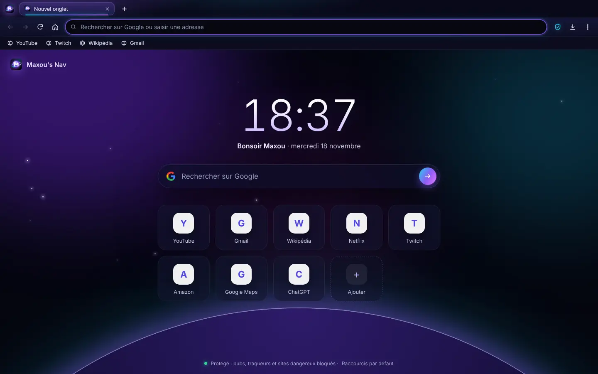
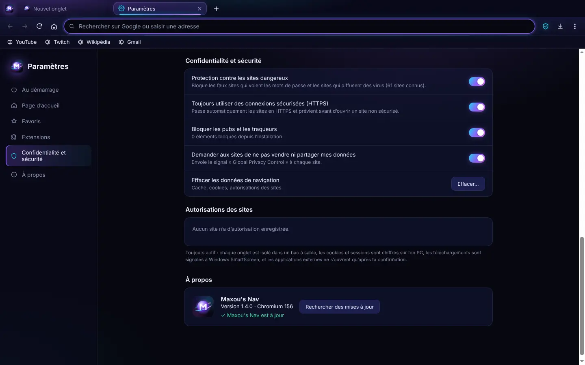

<p align="center">
  <a href="https://maxoulfrdev.github.io/maxous-nav/"></a>
</p>

<p align="center">
  <a href="https://github.com/Maxoulfrdev/maxous-nav/releases/latest"></a>
  
  
</p>

<h3 align="center">
  <a href="https://github.com/Maxoulfrdev/maxous-nav/releases/latest">⬇️ Télécharger pour Windows</a>
  &nbsp;·&nbsp;
  <a href="https://maxoulfrdev.github.io/maxous-nav/">🌐 Site officiel</a>
</h3>

---

## ✨ Fonctions

| | |
|---|---|
| 🛡️ **Bloqueur de pubs intégré** | Pubs, traqueurs et pop-ups bloqués (EasyList / EasyPrivacy), listes mises à jour toutes seules |
| 🚫 **Anti-hameçonnage** | ~20 000 faux sites et sites à virus bloqués avant de s'afficher |
| 🧩 **Extensions Chrome** | Installe tes extensions depuis le Chrome Web Store |
| 🔄 **Mises à jour automatiques** | Les nouvelles versions s'installent en silence, comme Chrome |
| ⭐ **Favoris et démarrage** | Barre de favoris, page d'accueil au choix, reprise de session ou pages au choix |
| ⚡ **Léger** | Onglets inutilisés mis en veille, démarrage instantané |

## 📸 Captures

<p align="center">
  
  
</p>
<p align="center">
  
</p>

## 🔒 Sécurité

- Chaque onglet et l'interface tournent dans un **bac à sable**
- **HTTPS forcé**, avec avertissement si un site ne le propose pas
- **Cookies et sessions chiffrés** sur le PC (DPAPI de Windows)
- Téléchargements dangereux bloqués, **SmartScreen** informé, confirmation avant d'ouvrir un programme
- Mises à jour vérifiées (source GitHub uniquement + empreinte SHA-256)
- Chaque version est **testée automatiquement sur Windows** avant d'être publiée

## 💿 Installation

1. Télécharge `Maxous-Nav-Installation-X.Y.Z.exe` depuis la [dernière version](https://github.com/Maxoulfrdev/maxous-nav/releases/latest).
2. Lance-le. Si Windows affiche *« Windows a protégé votre ordinateur »* : **Informations complémentaires** → **Exécuter quand même**.
3. C'est tout. Maxou's Nav se met ensuite à jour tout seul.

---

<details>
<summary><b>👩‍💻 Pour les développeurs</b></summary>

```bash
npm install          # installe les dépendances (+ correctifs automatiques)
npm start            # lance Maxou's Nav en mode développement
```

**Publier une nouvelle version** : change `version` dans `package.json` puis envoie le code sur `main`.
GitHub Actions compile l'appli sur Windows, lance l'auto-test, puis publie la release.
Les navigateurs installés se mettent à jour tout seuls.

Le site de présentation (`site/`) est publié automatiquement sur GitHub Pages.
</details>
